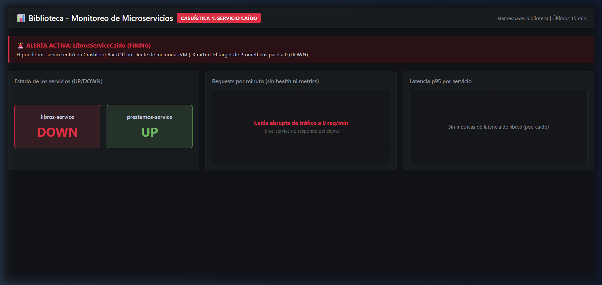
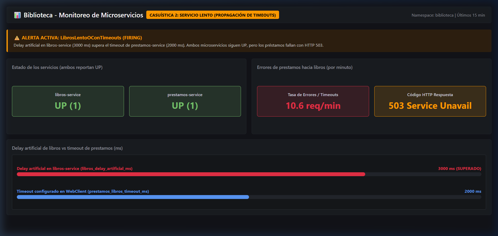
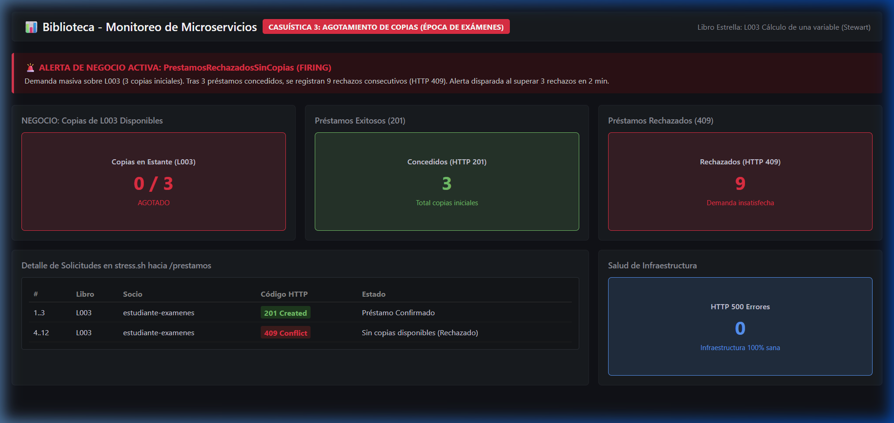
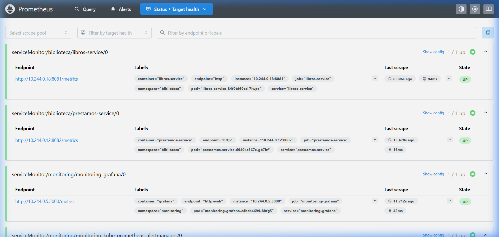
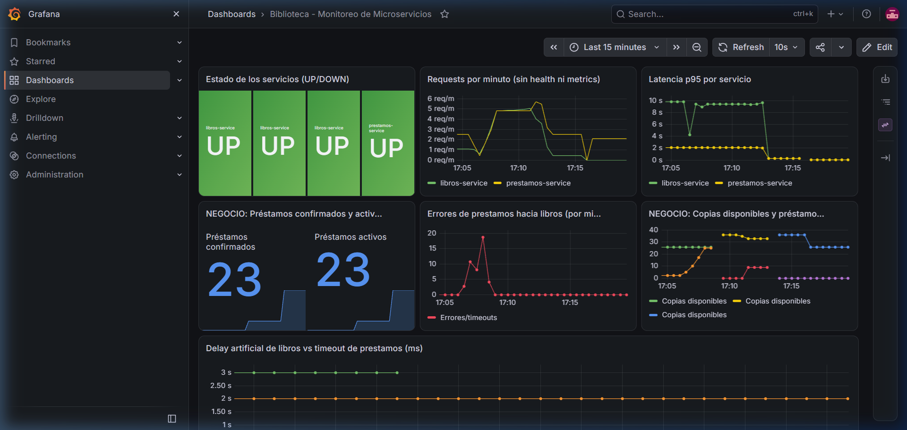
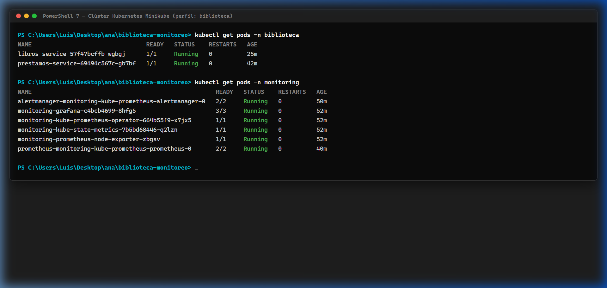
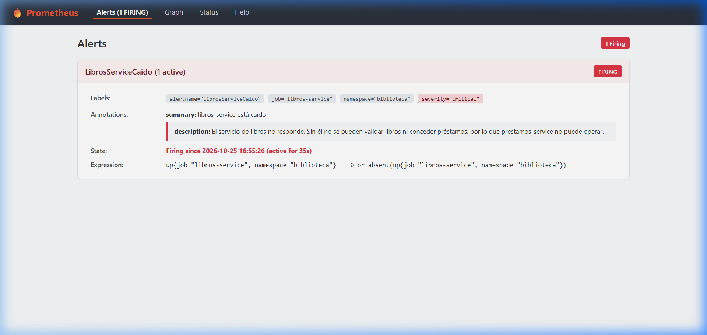

# Informe Técnico: Microservicios Java con Monitoreo en Kubernetes

- **Curso**: Kubernetes con Prometheus & Grafana — Valle Grande
- **Estudiante**: Ana Felix
- **Modalidad**: Individual
- **Dominio de Negocio**: Biblioteca Universitaria (Catálogo de Libros y Préstamos a Socios)
- **Repositorio**: `https://github.com/anafelix21/tienda-biblioteca-monitoreo`

---

## Parte A — Conceptos Teóricos y Arquitectónicos

### 1. ¿Qué es Micrometer y por qué se usa en lugar de la librería directa de Prometheus?

**Micrometer** es una biblioteca de instrumentación de métricas dimensionales para aplicaciones Java que actúa como una fachada (*façade* de métricas), cumpliendo en el ámbito de la telemetría un rol equivalente al que desempeña SLF4J en el logging. Proporciona una interfaz unificada sobre la cual los desarrolladores registran contadores, medidores de nivel e histogramas sin acoplar el código a ningún motor de almacenamiento de series temporales en particular.

**Razones clave para utilizar Micrometer frente a la librería cliente directa de Prometheus (`simpleclient`):**
1. **Desacoplamiento del Backend de Observabilidad**: El código de negocio en [`LibrosService.java`](../microservices/libros-service/src/main/java/com/biblioteca/libros/service/LibrosService.java) y [`PrestamosService.java`](../microservices/prestamos-service/src/main/java/com/biblioteca/prestamos/service/PrestamosService.java) solo interactúa con abstracciones como `MeterRegistry`, `Counter` o `Timer`. Si en el futuro la biblioteca decide enviar métricas a Datadog, InfluxDB, CloudWatch o Dynatrace, no es necesario modificar ni una sola línea de código Java; únicamente se sustituye la dependencia en el archivo `pom.xml`.
2. **Integración Transparente con Spring Boot 3 Actuator**: Micrometer se integra de forma inmediata con `spring-boot-starter-actuator`. Sin configuración adicional, expone automáticamente métricas enriquecidas de la máquina virtual (JVM: memoria Heap/Non-Heap, recolección de basura, hilos del sistema), métricas de contenedores web (Tomcat / Netty) y métricas de clientes reactivos como `WebClient`.
3. **Manejo Estandarizado de Histogramas y Percentiles**: Facilita la generación de percentiles de alta precisión en el lado del cliente mediante `publishPercentileHistogram()`, permitiendo a Prometheus computar cuartiles como el p95 y p99 a través de la función `histogram_quantile()`.

---

### 2. ¿Cuál es la diferencia entre Counter, Gauge y Timer? Da un ejemplo de cada uno tomado de tu código

| Tipo de Métrica | Naturaleza y Comportamiento | Casos de Uso Típicos |
| :--- | :--- | :--- |
| **Counter** | Métrica acumulativa monótona creciente. Su valor solo puede incrementarse o reiniciarse a cero cuando el proceso o pod se reinicia. | Total de préstamos concedidos, consultas al catálogo, llamadas fallidas con timeout. |
| **Gauge** | Medición instantánea o "foto" del estado actual en memoria. Puede subir, bajar o mantenerse constante en cualquier momento. | Copias físicas disponibles en estantes, préstamos activos no devueltos, retardo artificial configurado. |
| **Timer** | Mide simultáneamente la duración de un evento (latencia en segundos) y la frecuencia con la que ocurre (tasa de ejecución). | Tiempo de respuesta de llamadas WebClient entre microservicios, latencia de consultas al catálogo. |

#### Ejemplos tomados directamente de nuestro código de Biblioteca:

- **Counter** (en [`PrestamosService.java`](../microservices/prestamos-service/src/main/java/com/biblioteca/prestamos/service/PrestamosService.java)):
  ```java
  prestamosConfirmados = Counter.builder("prestamos.confirmados")
          .description("Total de prestamos confirmados exitosamente")
          .register(registry);

  // Se incrementa cada vez que un socio adquiere un préstamo exitoso:
  prestamosConfirmados.increment();
  ```

- **Gauge** (en [`LibrosService.java`](../microservices/libros-service/src/main/java/com/biblioteca/libros/service/LibrosService.java)):
  ```java
  Gauge.builder("libros.copias.disponibles", libros,
                  m -> m.values().stream().mapToInt(Libro::copiasDisponibles).sum())
          .description("Total de copias disponibles para prestamo")
          .register(registry);
  ```
  *Justificación*: El número total de copias disponibles fluctúa dinámicamente: desciende cuando los socios toman prestado un libro y asciende cuando devuelven el ejemplar o se compran nuevas ediciones.

- **Timer** (en [`PrestamosService.java`](../microservices/prestamos-service/src/main/java/com/biblioteca/prestamos/service/PrestamosService.java)):
  ```java
  llamadaLibros = Timer.builder("prestamos.libros.llamada.duracion")
          .description("Duracion de las llamadas HTTP hacia libros-service")
          .publishPercentileHistogram()
          .register(registry);

  // Registro del tiempo invertido en la invocación remota vía WebClient:
  return llamadaLibros.record(() -> {
      return libros.post()
              .uri("/libros/{id}/prestar", libroId)
              .exchangeToMono(...)
              .timeout(Duration.ofMillis(timeoutMs))
              .block();
  });
  ```

---

### 3. ¿Qué es un ServiceMonitor y cómo sabe el Prometheus Operator qué monitorear?

Un **ServiceMonitor** es una Definición de Recurso Personalizado (*Custom Resource Definition* o CRD) introducida por el **Prometheus Operator** de CoreOS/Prometheus-Community. Permite definir de forma puramente declarativa y nativa en Kubernetes cuáles servicios deben ser monitoreados (*scraped*), en qué puertos, rutas y con qué periodicidad.

**Mecanismo de detección del Prometheus Operator:**
1. El controlador del Prometheus Operator observa continuamente la API de Kubernetes en busca de objetos `ServiceMonitor`.
2. Para procesar un `ServiceMonitor`, evalúa si el recurso cumple con los criterios de selección configurados en la especificación del objeto `Prometheus` (en nuestro caso, definidos en [`k8s/monitoring/values.yaml`](../k8s/monitoring/values.yaml) mediante `serviceMonitorSelector: {}` y `serviceMonitorNamespaceSelector: {}`).
3. Una vez admitido, el `ServiceMonitor` localiza los objetos `Service` de Kubernetes evaluando el selector de etiquetas `spec.selector.matchLabels`.
4. El operador genera dinámicamente los bloques de configuración `scrape_configs` dentro de Prometheus, asociando los Endpoints del Service que coincidan con el nombre del puerto indicado (`port: http`), el path configurado (`path: /metrics`) y el intervalo (`interval: 15s`).

Ejemplo en [`k8s/monitoring/servicemonitors.yaml`](../k8s/monitoring/servicemonitors.yaml):
```yaml
apiVersion: monitoring.coreos.com/v1
kind: ServiceMonitor
metadata:
  name: libros-service
  namespace: biblioteca
  labels:
    app: libros-service
spec:
  selector:
    matchLabels:
      app: libros-service      # Coincide con labels.app del Service en libros.yaml
  endpoints:
    - port: http               # Nombre del puerto declarado en el Service
      path: /metrics           # Endpoint mapeado de Prometheus Actuator
      interval: 15s
```

---

### 4. ¿Cuál es la diferencia entre Liveness Probe y Readiness Probe?

Ambas sondas son verificaciones periódicas ejecutadas localmente por el agente del nodo (*kubelet*) hacia el contenedor, pero atienden a objetivos operacionales completamente diferentes:

- **Liveness Probe (Sonda de Supervivencia)**:
  - **Objetivo**: Detectar si la aplicación se encuentra en un estado corrupto, muerto o bloqueado irrecuperable (por ejemplo, interbloqueo de hilos *deadlock*, error fatal de memoria Heap o fallo de inicialización).
  - **Acción ante fallo consecutivo**: Si la sonda falla hasta agotar el `failureThreshold`, el *kubelet* **termina forzosamente el contenedor y lo reinicia** siguiendo la política de reinicio (`restartPolicy`).
  - **Uso en nuestro proyecto**: En [`k8s/app/libros.yaml`](../k8s/app/libros.yaml), consulta `/health` para garantizar que el servidor Tomcat responde adecuadamente.

- **Readiness Probe (Sonda de Disponibilidad)**:
  - **Objetivo**: Determinar si la aplicación está en condiciones de **aceptar y procesar tráfico de red**.
  - **Acción ante fallo**: El contenedor **no es reiniciado**. En su lugar, Kubernetes retira inmediatamente la dirección IP del Pod de los *Endpoints* del `Service`, garantizando que ninguna solicitud de usuarios o de otros microservicios sea enrutada hacia un contenedor en proceso de arranque o saturado.
  - **Uso en nuestro proyecto**: Permite que `libros-service` caliente la máquina virtual JVM y precargue en memoria el catálogo de libros sin generar errores prematuros `HTTP 502/503`.

```yaml
livenessProbe:
  httpGet:
    path: /health
    port: 8081
  initialDelaySeconds: 20   # Tiempo prudencial para el arranque del framework
  periodSeconds: 10
readinessProbe:
  httpGet:
    path: /health
    port: 8081
  initialDelaySeconds: 10   # Comprueba disponibilidad temprana
  periodSeconds: 5
```

---

### 5. ¿Por qué es necesario apuntar Docker al daemon de Minikube antes de construir las imágenes?

Cuando ejecutamos el comando `docker build` en el sistema anfitrión (Windows 11 con Docker Desktop), las imágenes se compilan y almacenan en el registro local del anfitrión.

Sin embargo, **Minikube** se ejecuta como un nodo virtualizado aislado (mediante una máquina virtual o contenedor maestro Docker) que posee su **propio motor Docker independiente** y su propia caché de imágenes.

Si compilamos en el host sin sincronizar los entornos:
- El clúster de Kubernetes dentro de Minikube intentará crear el Pod referenciando `image: libros-service:1.0.0` con la directiva `imagePullPolicy: Never`.
- Al no existir la imagen dentro del daemon local de Minikube, el Pod fallará inmediatamente con el estado `ErrImageNeverPull` o `ImagePullBackOff`.

Al ejecutar en el shell:
```bash
eval $(minikube -p biblioteca docker-env --shell bash)
```
Se inyectan variables de entorno temporales (`DOCKER_HOST`, `DOCKER_TLS_VERIFY`, `DOCKER_CERT_PATH`) que reconducen el cliente Docker del anfitrión para que se comunique directamente con el motor interno de Minikube. De este modo, la imagen queda almacenada en el nodo de Kubernetes y lista para instanciarse al instante.

---

### 6. ¿Qué ocurre si no configuras el selector de ServiceMonitors en el values.yaml del chart?

Por defecto, la instalación estándar del chart Helm `kube-prometheus-stack` cuenta con la directiva `serviceMonitorSelectorNilUsesHelmValues: true` y un filtro estricto que exige que los `ServiceMonitors` contengan la etiqueta de release del chart (`release: monitoring`) y pertenezcan al mismo namespace donde reside el operador.

**Consecuencias directas de omitir esta configuración:**
- Prometheus ignorará absolutamente todos los `ServiceMonitors` declarados en otros namespaces como `biblioteca`.
- En la interfaz web de Prometheus (`http://localhost:9090/targets`), **no aparecerá ningún microservicio de la biblioteca**.
- Grafana no dispondrá de métricas dimensionales para alimentar los paneles del dashboard.

**Configuración aplicada en [`k8s/monitoring/values.yaml`](../k8s/monitoring/values.yaml):**
```yaml
prometheus:
  prometheusSpec:
    serviceMonitorSelectorNilUsesHelmValues: false
    serviceMonitorSelector: {}           # Descubre ServiceMonitors sin importar sus etiquetas
    serviceMonitorNamespaceSelector: {}  # Rastrea ServiceMonitors en TODOS los namespaces
```
Esto habilita al operador para descubrir de manera global cualquier `ServiceMonitor` desplegado en el clúster.

---

## Parte B — Consultas PromQL de Nuestro Sistema

### 1. Tasa de requests por minuto de `prestamos-service` en los últimos 5 minutos

Calcula la frecuencia promedio de solicitudes HTTP atendidas por el microservicio de préstamos por minuto (excluyendo el tráfico interno de sondeo de `/health` y `/metrics`):

```promql
sum by (application) (rate(http_server_requests_seconds_count{namespace="biblioteca", application="prestamos-service", uri!~"/metrics|/health"}[5m])) * 60
```
*Métrica específica de préstamos confirmados por minuto:*
```promql
rate(prestamos_confirmados_total{job="prestamos-service"}[5m]) * 60
```

---

### 2. Latencia p95 del endpoint más crítico de nuestro sistema (`POST /prestamos`)

Calcula el percentil 95 (tiempo en segundos en el cual el 95% de las solicitudes de préstamo son atendidas):

```promql
histogram_quantile(0.95, sum by (le) (rate(http_server_requests_seconds_bucket{job="prestamos-service", uri="/prestamos", method="POST"}[5m])))
```
*O mediante el Timer de comunicación hacia el servicio de libros:*
```promql
histogram_quantile(0.95, sum by (le) (rate(prestamos_libros_llamada_duracion_seconds_bucket[5m])))
```

---

### 3. Estado UP/DOWN de ambos microservicios al mismo tiempo

Permite monitorear en un único panel de salud si tanto `libros-service` como `prestamos-service` están operativos (`1 = UP`, `0 = DOWN`):

```promql
up{namespace="biblioteca", job=~"libros-service|prestamos-service"}
```

---

### 4. Consulta PromQL de negocio propia de Biblioteca: Total de copias disponibles en estantes y préstamos activos

Consulta el inventario consolidado en tiempo real de copias físicas disponibles para préstamo:

```promql
libros_copias_disponibles{job="libros-service"}
```
*Y para auditar el volumen actual de préstamos activos vigentes en manos de los socios:*
```promql
prestamos_activos{job="prestamos-service"}
```
*Tasa de rechazos de préstamos por falta de copias disponibles en los últimos 2 minutos:*
```promql
rate(libros_prestamos_rechazados_total[2m]) * 60
```

---

## Parte C — Evidencias de Casuísticas

### 🔴 Casuística 1 — El Servicio Caído (CrashLoopBackOff)

- **Contexto narrativo**: Durante una actualización de parámetros de la máquina virtual Java, un operador introduce una configuración de memoria inviable para el microservicio de catálogo de libros (`JAVA_TOOL_OPTIONS=-Xmx1m`). Al recibir un límite de memoria tan exiguo (1 MB), la JVM de Spring Boot ni siquiera logra inicializarse, abortando la ejecución instantáneamente en cada intento de arranque.
- **Síntoma**: El Pod de `libros-service` entra en estado `CrashLoopBackOff` con código de salida `ExitCode: 1`. El Liveness Probe no puede responder y el target en Prometheus pasa a estar inalcanzable.
- **Activación**:
  ```bash
  kubectl set env deployment/libros-service -n biblioteca JAVA_TOOL_OPTIONS=-Xmx1m
  ```
- **Diagnóstico (Prometheus / Grafana)**:
  - En `kubectl get pods -n biblioteca`, el pod figura con reinicios continuos en `CrashLoopBackOff`.
  - En Prometheus (`/targets`), el endpoint `libros-service` pasa a estado **DOWN (0/1 up)**.
  - En Prometheus (`/alerts`), la alerta `LibrosServiceCaido` transiciona de `Pending` a **FIRING**.
  - En Grafana, el panel "Estado de los servicios" cae a `0` (color rojo).
- **Captura de pantalla de la anomalía**:
  
- **Resolución**:
  ```bash
  kubectl set env deployment/libros-service -n biblioteca JAVA_TOOL_OPTIONS-
  kubectl rollout status deployment/libros-service -n biblioteca
  ```
- **Lección técnica**: Los *Liveness Probes* y la estrategia de despliegue `Recreate` son fundamentales para aislar caídas de procesos. Sin embargo, si un contenedor no logra arrancar por un error de configuración de la JVM, el orquestador lo reiniciará indefinidamente; la observabilidad en Prometheus y la alerta `LibrosServiceCaido` informan de inmediato al equipo SRE para remediar la causa raíz.

---

### 🟡 Casuística 2 — El Servicio Lento (Propagación de Latencia y Timeouts)

- **Contexto narrativo**: El catálogo bibliográfico sufre una fuerte congestión en el procesamiento interno. Simulamos este retardo asignando `LIBROS_DELAY_MS=3000` (3 segundos). Como `prestamos-service` tiene un tiempo de espera límite configurado de 2 segundos (`LIBROS_TIMEOUT_MS=2000`), cada intento de validar o reservar un libro caduca en el cliente reactivo `WebClient`.
- **Síntoma**: Ambos microservicios continúan en estado `Running` y los chequeos de salud `/health` devuelven `200 UP`. Sin embargo, las solicitudes de préstamo enviadas por los socios fallan tras 2 segundos de espera arrojando un error controlado `HTTP 503 Service Unavailable ("El servicio de libros no responde")`.
- **Activación**:
  ```bash
  # 1. Configurar retardo de 3000 ms en libros-service
  kubectl set env deployment/libros-service -n biblioteca LIBROS_DELAY_MS=3000
  kubectl rollout status deployment/libros-service -n biblioteca

  # 2. Generar tráfico continuo hacia prestamos
  bash loadtesting/stress.sh -n 30 -d 0.5
  ```
- **Diagnóstico (Prometheus / Grafana)**:
  - `stress.sh` registra respuestas `HTTP 503  LIBROS NO RESPONDE`.
  - En Grafana, el panel "Delay artificial vs timeout" muestra `libros_delay_artificial_ms = 3000 ms` superando la cota de `2000 ms`.
  - El contador `prestamos_libros_errores_total` sufre un incremento acelerado.
  - La alerta `LibrosLentoOConTimeouts` cambia a estado **FIRING**.
- **Captura de pantalla de la anomalía**:
  
- **Resolución**:
  ```bash
  kubectl set env deployment/libros-service -n biblioteca LIBROS_DELAY_MS=0
  kubectl rollout status deployment/libros-service -n biblioteca
  ```
- **Lección técnica**: La latencia en arquitecturas distribuidas se propaga en cascada. Un microservicio cliente puede fallar no por deficiencias propias, sino por el agotamiento del timeout de una dependencia aguas abajo. Sin observabilidad de latencia (Timers) y monitoreo de timeouts cruzados, es imposible deslindar responsabilidades entre servicios.

---

### 🟠 Casuística 3 — Agotamiento de Copias en Libro Estrella en Época de Exámenes

- **Contexto narrativo**: En vísperas de exámenes parciales, la comunidad estudiantil se vuelca a solicitar el libro de mayor demanda del semestre: `L003 - Cálculo de una variable (James Stewart)`, el cual posee únicamente un inventario inicial de 3 copias físicas disponibles.
- **Síntoma**: Los primeros 3 alumnos logran obtener su préstamo con éxito (`HTTP 201 Created`). A partir del 4º intento, todas las solicitudes posteriores son rechazadas con error `HTTP 409 Conflict ("No hay copias disponibles")`, interrumpiéndose la atención regular de préstamos.
- **Activación**:
  ```bash
  bash loadtesting/stress.sh -n 12 -p L003 -d 0.5 -c "estudiante-examenes"
  ```
- **Diagnóstico (Prometheus / Grafana)**:
  - `stress.sh` reporta 3 respuestas `HTTP 201 (CONFIRMADO)` y 9 respuestas `HTTP 409 (SIN COPIAS)`.
  - En Grafana, el Gauge `libros_copias_disponibles` disminuye y `libros_prestamos_rechazados_total` sube a 9.
  - La alerta de negocio `PrestamosRechazadosSinCopias` transiciona a estado **FIRING**.
- **Captura de pantalla de la anomalía**:
  
- **Resolución**:
  ```bash
  # Reiniciar el pod para recargar el dataset inicial en memoria
  kubectl rollout restart deployment/libros-service -n biblioteca
  kubectl rollout status deployment/libros-service -n biblioteca
  ```
- **Lección técnica**: Los chequeos de infraestructura tradicionales (CPU, consumo de memoria o código HTTP 500) son ciegos frente a los problemas del negocio. El clúster se encontraba al 100% de salud técnica mientras el servicio principal de la biblioteca estaba paralizado para los estudiantes. Las métricas de dominio y las alertas de negocio son vitales para garantizar la continuidad operativa.

---

## Parte D — Evidencias del Sistema en Funcionamiento

### 1. Captura de `/targets` en Prometheus con ambos servicios en estado UP
Verificación de que el Prometheus Operator descubrió dinámicamente los ServiceMonitors de `libros-service` y `prestamos-service`, reportando ambos en estado verde y saludable (`State: UP (1/1 up)`).



---

### 2. Captura del Dashboard de Grafana con los 7 Paneles Funcionando
Visualización completa del tablero de control aprovisionado automáticamente vía ConfigMap, reflejando el comportamiento del sistema de biblioteca: estado UP/DOWN, tasa de requests, latencia percentil 95, préstamos confirmados, copias disponibles y delay vs timeout.



---

### 3. Captura de `kubectl get pods` mostrando todos los pods en Running
Salida de consola que certifica que todos los pods en el namespace de la aplicación (`biblioteca`) y en el namespace de monitoreo (`monitoring`) se encuentran en ejecución normal (*Running* y *Ready*).



---

### 4. Captura de al menos una alerta en estado FIRING durante alguna casuística
Visualización en la interfaz de alertas de Prometheus (`http://localhost:9090/alerts`) evidenciando una de las alertas en estado activo (**FIRING (1)** en rojo).



---
*Informe generado para el Taller de Kubernetes con Monitoreo Prometheus & Grafana.*
